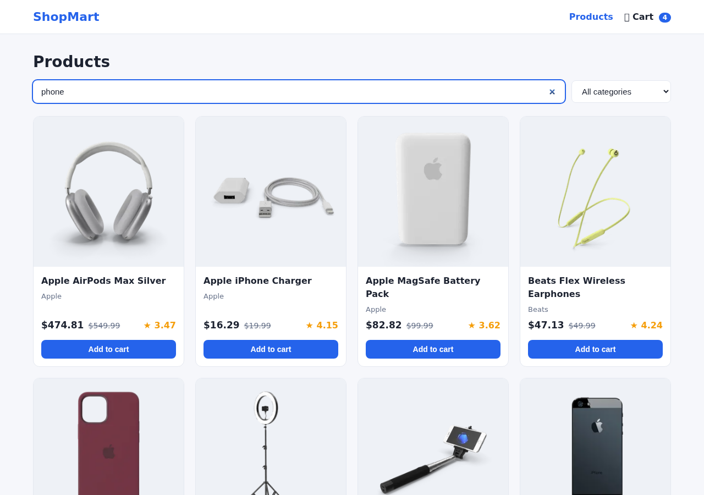
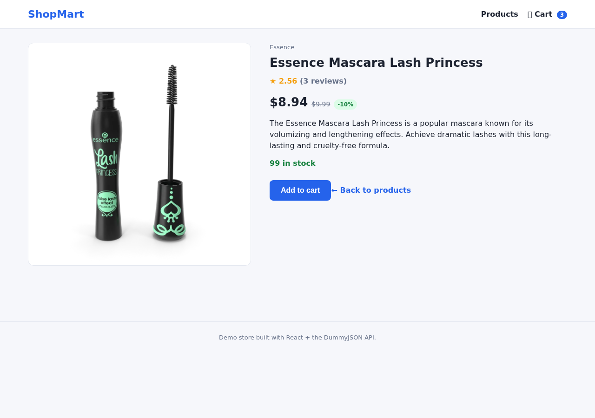
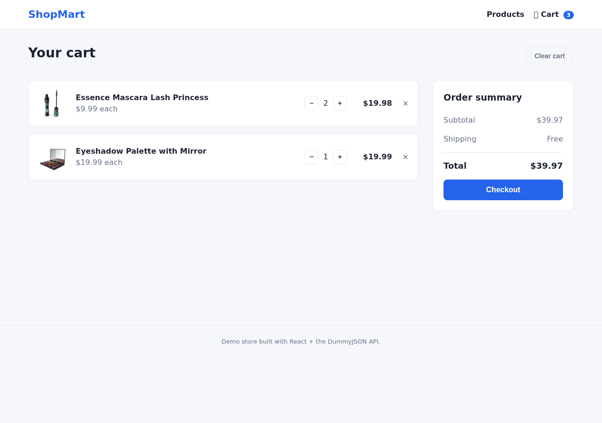
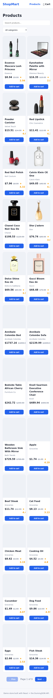

# ShopMart - E-commerce Catalog with Cart

A small online store built with React. Browse a real product catalog from the
[DummyJSON](https://dummyjson.com) API, search and filter by category, view
product details, and manage a shopping cart that survives page reloads.

**Live demo:** https://malakmo7amed309.github.io/shop-app/

## Features

- Product catalog with pagination, powered by the live DummyJSON API
- Live search across product titles and descriptions
- Category filtering (beauty, fragrances, furniture, groceries and more)
- Product details page with images, rating, price and stock info
- Shopping cart with add, remove and quantity controls
- Cart totals computed automatically and persisted in `localStorage`
- Loading, error and empty states on every data view
- Fully responsive layout (desktop grid to single-column mobile)

## Tech stack

- React 19 + Vite
- React Router (catalog, details, cart and 404 routes)
- Context API + `useReducer` for cart state
- `localStorage` for cart persistence
- Axios for API requests
- Plain modern CSS (custom properties, grid, flexbox)

## Screenshots

| Catalog | Product details |
| --- | --- |
|  |  |

| Cart | Mobile |
| --- | --- |
|  |  |

## Run locally

```bash
npm install
npm run dev
```

Then open http://localhost:5173/shop-app/.

To create a production build:

```bash
npm run build
npm run preview
```

No API key is needed: DummyJSON is a free fake-store API for learning and
prototyping.

## How the code works

New to this codebase? Read [docs/how-it-works.md](docs/how-it-works.md) for a
plain-language walkthrough of the cart state, the API layer and the main
React concepts used here.
